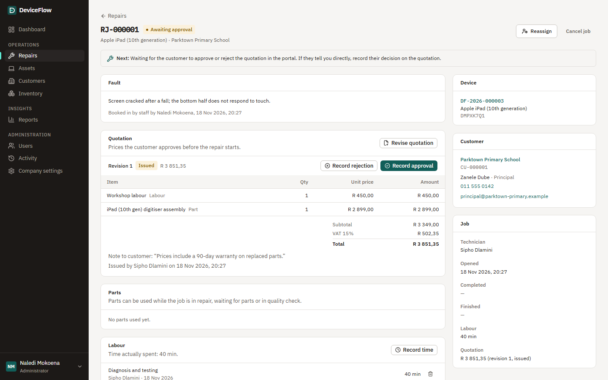
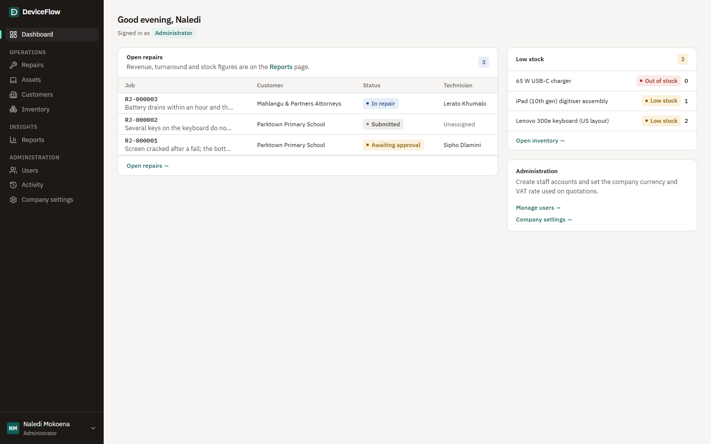
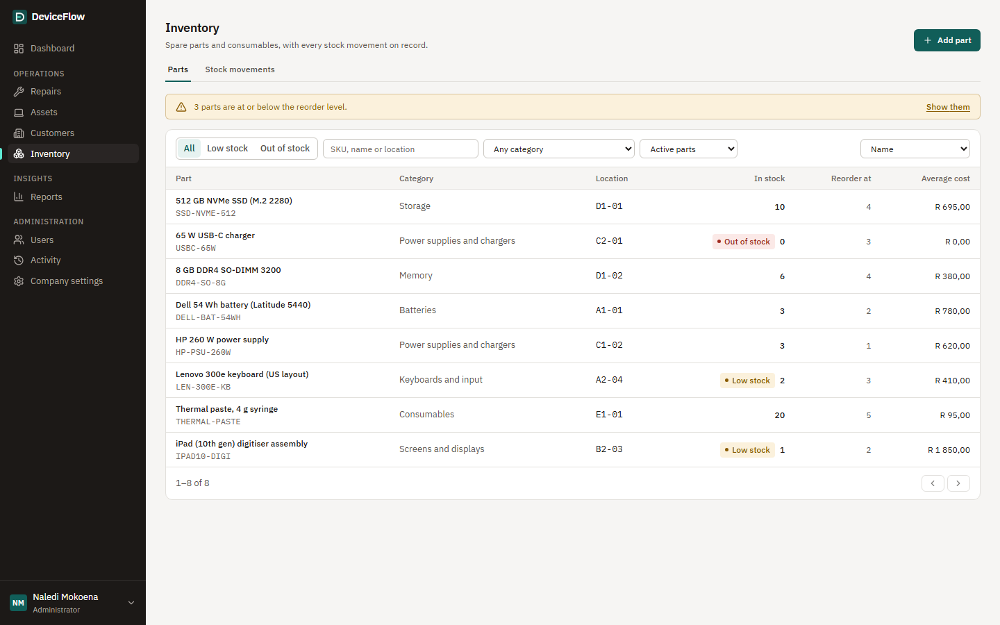
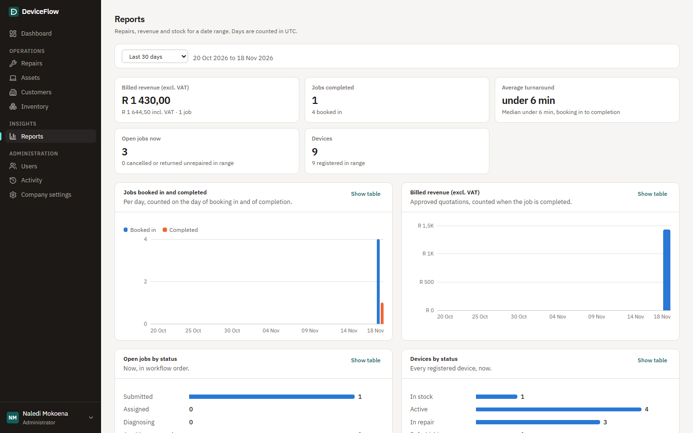
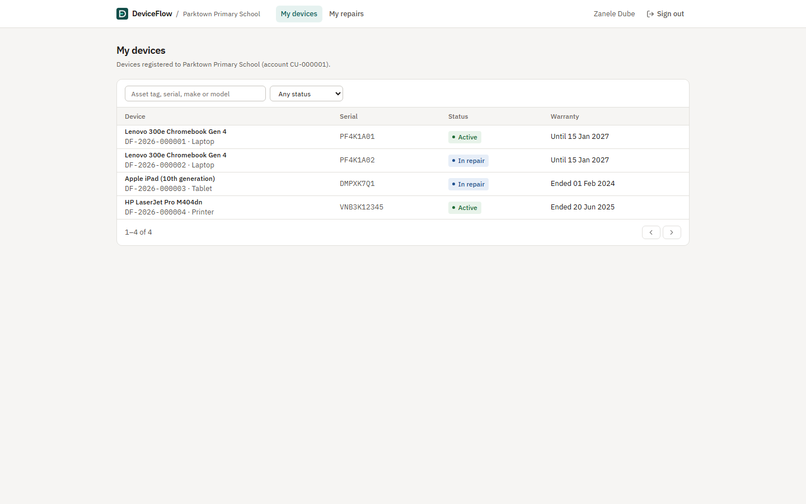

# DeviceFlow

**Device lifecycle and repair management for technology service providers** that look
after laptops, tablets and printers for schools, businesses and individual customers.
DeviceFlow keeps the asset register, the repair workshop, spare-parts stock and the
customer's own view of their devices in one accountable record.

[](https://github.com/moeletsimelamu/deviceflow/actions/workflows/ci.yml)




## What it does

| Area                   | What you can do                                                                                                                                                                                                                     |
| ---------------------- | ----------------------------------------------------------------------------------------------------------------------------------------------------------------------------------------------------------------------------------- |
| **Repairs**            | Book a device in, assign a technician, record diagnosis notes and labour, issue quotations with VAT, get the customer's approval, then repair, quality-check, complete and close. A state machine allows only valid moves per role. |
| **Customer portal**    | Customers see only their own organisation's devices and repairs, request repairs, and approve or decline quotations online.                                                                                                         |
| **Assets & customers** | A register of every device with generated asset tags, warranty status, ownership and a full lifecycle history; customer accounts with contacts and portal users.                                                                    |
| **Inventory**          | Parts with reorder levels, deliveries at weighted average cost, adjustments with reasons, parts used on repairs, and an append-only stock ledger. Stock can never go below zero, even under concurrent use.                         |
| **Reports**            | Billed revenue, jobs completed, turnaround, open jobs by status, technician workload, parts consumption and stock value for any date range. Every chart can also be read as a table.                                                |
| **Administration**     | Staff users and roles, company settings (currency and VAT rate), and an activity log of who changed what, and when.                                                                                                                 |

Four roles (administrator, technician, inventory manager and customer) each see only
what they need: technicians work their own jobs, inventory managers see stock and the
parts side of repairs, and customers see only their own records.

## Screenshots

|                                                                                          |                                                                                                        |
| ---------------------------------------------------------------------------------------- | ------------------------------------------------------------------------------------------------------ |
|  |  |
| **Dashboard:** open repairs and low stock at a glance                                    | **Inventory:** stock, reorder levels and average cost                                                  |
|  |        |
| **Reports:** revenue, turnaround and workload by date range                              | **Customer portal:** a customer's own devices and repairs                                              |

Screenshots show the built-in demo data.

## Engineering highlights

- **Authorisation tested end to end.** A hand-written matrix calls each of the 72 API
  operations signed out and as every role, and a route count ties it to what the
  server actually mounts, so no endpoint ships without a decision about who may call
  it.
- **One set of rules on both sides.** Zod schemas, roles, permissions, the repair state
  machine and money calculations live in a shared package used by the API and the web
  app.
- **Money and stock done carefully.** Amounts are integer cents in ZAR with VAT; stock
  changes are row-locked database transactions recorded in an immutable ledger.
- **Accessible by default.** Every screen passes axe-core's WCAG 2.2 AA rules, with
  separate keyboard tests for focus, dialogs and the skip link.
- **Tested at every layer.** About 580 unit and integration tests (Vitest and Supertest
  against a real PostgreSQL), plus Playwright browser tests of the full repair flow
  from booking in to the revenue report, run in CI against the production Docker
  images behind nginx.
- **Secure sessions.** HTTP-only cookie sessions with idle and absolute expiry, CSRF
  protection, sign-in rate limiting, strict security headers and an audit trail.

## Project status

Phases 1 to 7 of the [roadmap](docs/PHASE-1-DISCOVERY.md) are complete: every module
above works end to end and is covered by the tests. **Production deployment (Phase 8)
has not been done yet.** DeviceFlow runs locally and as a Docker Compose stack, but it
is not hosted anywhere. Known limitations are listed in
[SECURITY.md](docs/SECURITY.md#known-limitations).

## Stack

| Layer    | Technology                                                                              |
| -------- | --------------------------------------------------------------------------------------- |
| Frontend | React 19, TypeScript 6, Vite 8, React Router 8, TanStack Query 5, Tailwind CSS 4, Radix |
| Backend  | Node.js 22, Express 5, Prisma 7, Zod 4, pino                                            |
| Database | PostgreSQL 17                                                                           |
| Testing  | Vitest, Supertest, Playwright, axe-core                                                 |
| Tooling  | npm workspaces, ESLint, Prettier, Docker Compose, nginx, GitHub Actions                 |

Exact versions and why they were chosen: [docs/ARCHITECTURE.md](docs/ARCHITECTURE.md#versions).

## Getting started

### Prerequisites

- **Node.js 22.13 or newer** (22.22+ recommended; see `.nvmrc`)
- **npm 11.21.1** for installs. npm 10.x fails on this dependency tree with
  `Cannot read properties of null (reading 'edgesOut')`. Upgrade with
  `npm install -g npm@11.21.1`, or prefix installs with `npx -y npm@11.21.1`.
- **Docker Desktop** (or Docker Engine with Compose v2)

### Local development

```bash
cp .env.example .env              # development-only values; edit if you like
docker compose up -d db           # PostgreSQL on localhost:5432 (+ test database)
npm install                       # also generates the Prisma client
npm run db:deploy                 # apply migrations
npm run db:seed                   # demo users (development only)
npm run dev                       # API on :3000, web on http://localhost:5173
```

### Full stack in Docker

```bash
cp .env.example .env
docker compose up -d --build                  # db → migrate → api → web
docker compose --profile demo run --rm seed   # demo users
```

Open <http://localhost:8080>.

### Demo sign-in

The seed creates one user per role. Every demo user's password is the value of
`SEED_DEFAULT_PASSWORD` in your `.env` (see `.env.example`).

| Role              | Email                       |
| ----------------- | --------------------------- |
| Administrator     | `admin@deviceflow.test`     |
| Technician        | `tech@deviceflow.test`      |
| Technician        | `tech2@deviceflow.test`     |
| Inventory manager | `inventory@deviceflow.test` |
| Customer (portal) | `portal@deviceflow.test`    |

The seed also creates three demo customer accounts (a school, a law firm and an
individual), their contacts, nine devices and four repair jobs at different stages.
The portal user belongs to Parktown Primary School and sees only that school's devices
and repairs; one of them has a quotation waiting for approval. Technician
`tech@deviceflow.test` is assigned that job. Eight parts are seeded with opening
stock (two at or below their reorder level, one out of stock), and the battery for
the laptop being repaired is recorded as used on its job.

These accounts exist for development and demos only. The seed refuses to run when
`NODE_ENV=production` unless it is explicitly confirmed, which only the local Docker
demo profile does.

## Common commands

| Command                              | What it does                                     |
| ------------------------------------ | ------------------------------------------------ |
| `npm run dev`                        | API and web with reload                          |
| `npm test`                           | All unit and integration tests (needs the db up) |
| `npm run test:e2e`                   | Playwright end-to-end tests (see TESTING.md)     |
| `npm run lint` / `npm run typecheck` | Static checks                                    |
| `npm run format`                     | Prettier                                         |
| `npm run db:migrate`                 | Create and apply a new migration (development)   |
| `npm run db:reset`                   | Drop, re-migrate and re-seed the development db  |
| `npm run build`                      | Production build of every workspace              |

## Documentation

| Document                                          | Contents                                                           |
| ------------------------------------------------- | ------------------------------------------------------------------ |
| [ARCHITECTURE.md](docs/ARCHITECTURE.md)           | Structure, layering, request lifecycle, key decisions              |
| [DATABASE.md](docs/DATABASE.md)                   | Schema, constraints, migrations                                    |
| [API.md](docs/API.md)                             | Endpoints, error format, conventions                               |
| [openapi.json](docs/openapi.json)                 | Generated OpenAPI 3.1 description (also at `/api/v1/openapi.json`) |
| [SECURITY.md](docs/SECURITY.md)                   | Authentication, authorisation, CSRF, secrets, known limits         |
| [TESTING.md](docs/TESTING.md)                     | Test strategy and how to run each suite                            |
| [DEPLOYMENT.md](docs/DEPLOYMENT.md)               | Container images, configuration, CI                                |
| [DESIGN.md](docs/DESIGN.md)                       | Design system and UI conventions                                   |
| [PHASE-1-DISCOVERY.md](docs/PHASE-1-DISCOVERY.md) | Requirements, business rules, roadmap                              |

## Repository layout

```
apps/api         Express API, Prisma schema and migrations, tests
apps/web         React single-page app
packages/shared  Zod schemas, roles and permissions shared by API and web
e2e/             Playwright end-to-end and accessibility tests
docker/          Dockerfiles, nginx config, Postgres init script, e2e stack override
docs/            Project documentation and screenshots
```

<details>
<summary><strong>Walkthrough: the main workflows, step by step</strong></summary>

1. **Register a customer** (Customers → New customer). Add contacts and, if the
   customer should use the portal, a portal user.
2. **Register a device** (Assets → Register asset, or Register device on a customer).
   The asset tag is generated. A serial already registered for that manufacturer is
   refused, and the message names the existing asset.
3. **Move it through its lifecycle** (Change status on the asset). Only allowed moves
   are offered; retiring and disposal need a reason. Every move is in the asset's
   history.
4. **Reassign or edit it** (Edit). Reassignment is recorded in the history.
5. **Export** the filtered asset list as CSV (administrators; audited).
6. **Review activity** (Administration → Activity): who did what, when, and what
   changed.
7. **Customers sign in** to the portal and see only their own devices and their
   status history.
8. **Book a device in for repair** (Repairs → Book in a repair, or from the asset
   page). Assign a technician; the device shows as in repair.
9. **Technicians work the job** (signed in as a technician, Repairs shows only their
   jobs): start the diagnosis, add notes, record time, prepare a quotation and issue
   it.
10. **The customer approves or declines** in the portal (My repairs). An administrator
    can record a decision made by phone, in person or by email instead.
11. **Repair, check, complete and close**: the status buttons offer only the moves the
    workflow allows for your role. Closing returns the device to active.
12. **Manage stock** (Inventory, as an inventory manager or administrator): add parts,
    receive deliveries (the average cost updates), adjust stock with a reason, and
    archive parts that are no longer kept. Every change is in the part's stock
    ledger, which cannot be edited.
13. **Use parts on a repair** (Parts panel on the job, while it is in repair, waiting
    for parts or in quality check): the units leave stock at once; unused units can
    be returned. Stock can never go below zero, even when two people take the last
    unit at the same moment.
14. **Watch low stock**: the dashboard and the Inventory page list parts at or below
    their reorder level.
15. **Read the reports** (Reports, as an administrator or inventory manager): choose a
    date range and see billed revenue, completed jobs, turnaround, open jobs by status
    and technician workload (administrators), and parts used, stock received, stock
    value and low stock (both roles). Every chart can be shown as a table.

</details>

## Licence

Copyright © 2026 Junior Melamu. All rights reserved. The source is public to read,
but it may not be used, copied or distributed without permission. See
[LICENSE](LICENSE).
